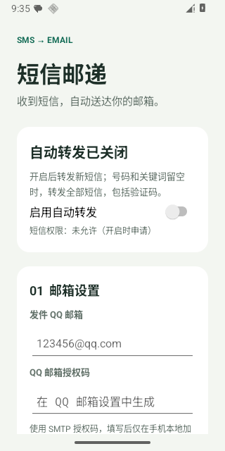

# 短信邮递

在安卓手机收到新短信后，通过 SMTP 自动转发至一个指定邮箱。针对 QQ 邮箱预填 `smtp.qq.com:465` 和 SSL/TLS，适用于个人自行安装。支持 Android 8（API 26）及以上，已在 Android 16 模拟器验证。

安装和 QQ 邮箱配置见 [安装说明](安装说明.md)。正式安装包请从 [Releases](https://github.com/ryan-yr/sms-mail-forwarder/releases) 下载。无需中转服务器。权限包含 RECEIVE_SMS、INTERNET、ACCESS_NETWORK_STATE 和可选通知权限；WorkManager 自动合并必要的后台任务权限。默认关闭转发，只处理用户启用后收到的新 SMS。

## 构建

使用 JDK 17、Android SDK 平台 35、Build Tools 35.0.0。在 Android Studio 打开此目录，或设置 `ANDROID_HOME` / 在 `local.properties` 指定自己的 SDK 路径，再执行：

```sh
./gradlew :app:assembleDebug :app:testDebugUnitTest :app:lintDebug
```

`assembleRelease` 输出未签名 APK，需用自己的密钥签名。Release APK 使用个人构建密钥签名；签名私钥留在开发者本地，未上传仓库。用其他密钥构建的 APK 无法覆盖安装；卸载会清除本地队列、设置和加密密钥。

安卓运行测试需要模拟器或测试设备：

```sh
./gradlew :app:connectedDebugAndroidTest
```

**仅在测试设备运行这些测试**：它们会清空本应用测试安装中的本地队列、取消后台任务并写入虚构邮箱配置。测试环境应断网，避免测试配置产生无意义的网络连接。

## 实现

- `SmsReceiver` 接收系统的 SMS_RECEIVED 广播，通过 BROADCAST_SMS 发送方权限限制外部伪造广播；分段正文合并后异步入库。
- `Crypto` 使用 Android Keystore 的 AES-GCM 密钥加密 SMTP 配置和短信队列，密钥不可由 App 导出。
- `QueueDb` 使用 SQLite 持久化正文，WorkManager 输入仅包含任务 ID，不受 WorkManager 10KB 输入限制影响；成功后擦除正文，只保留最多 200 条成功状态。
- `Scheduler` 按发送号码、时间、正文生成稳定去重 ID；每个任务固定入队时的收件地址，发送时读取当前 SMTP 凭据。关闭时不接收新任务，旧任务暂停。
- `MailWorker` 通过网络约束、加急请求和指数退避发送；自动尝试最多 10 次，永久失败可手动恢复。系统后台限制意味着无法承诺秒到。
- `SmtpSender` 使用 JavaMail 的 SMTP AUTH 和 SSL/TLS 或必需 STARTTLS，校验服务器证书链和域名，只启用 TLS 1.2。SMTP 服务器接受 DATA 后，QUIT 连接关闭失败不会触发重复重试。

SMTP 接受邮件与最终投递到收件箱不同；SMTP 和本地数据库之间无法建立一个事务，极少数情况下会重复发送，邮件附稳定转发编号。RCS、彩信和系统限制的验证码广播不在可靠实时转发范围内。

## 测试

本地 JVM 测试覆盖筛选、去重和邮件头输入检查，以及真实本地 TLS SMTP 会话、UTF-8 长正文、稳定 Message-ID 和服务器域名不匹配的拒绝。测试证书 `smtp-test.p12` 仅供测试，密码为 `test-password`，不会打包进正式 App。Android 运行测试覆盖 Keystore 加密、长正文持久化、成功擦除、关闭开关、去重、收件人快照和启动界面。

本项目固定使用 AGP 8.9.2、Gradle 8.11.1 和 WorkManager 2.10.1，以保持所验证的构建组合；静态检查可能提示依赖的新版本。升级依赖后应重新验证后台行为。

## 第三方组件

- AndroidX WorkManager 及依赖：Apache License 2.0。
- JavaMail / Android Activation 1.6.7：CDDL 1.1 / GPLv2 with Classpath Exception，项目页面：https://javaee.github.io/javamail/ 。
- Gradle Wrapper：Apache License 2.0。

测试结果见 [验证记录](验证记录.md)。真实三星手机的 One UI 后台运行和 QQ 邮箱收信需在手机上完成验证。

## 界面预览


